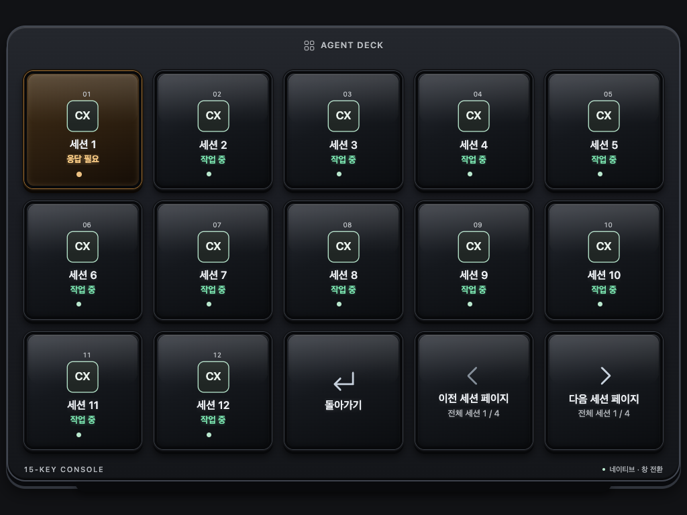

# Agent Deck

브라우저를 **15개 정사각형 키를 가진 개인 LAN 컨트롤 덱**으로 사용합니다. PC localhost에서 키와 동작을 편집하고, 페어링한 태블릿·휴대폰에서는 저장된 동작을 실행합니다. 별도 하드웨어는 필요하지 않습니다.

A private-LAN browser control deck with host-only authoring, paired controllers, and optional coding-agent integrations. **Experimental, MIT-licensed source release; not an Internet-facing service.**



위 화면은 회귀 테스트의 합성 세션입니다. 개인 터미널·계정·실제 작업 화면이 아닙니다. 앱 이름은 식별용이며, 아이콘은 공식 로고가 아닌 자체 제작 문자 배지입니다. 해당 서비스와의 제휴나 하드웨어 호환성을 뜻하지 않습니다.

## 시작하기

**Node.js 24 이상과 npm**이 필요합니다. 이번 릴리스의 전체 검증 환경은 macOS / Node.js 26입니다.

```sh
git clone https://github.com/adm-humanerd/agent-deck.git
cd agent-deck
npm ci
npm start
```

1. 호스트 PC에서 <http://127.0.0.1:43187/>를 엽니다.
2. **기기 연결**에서 LAN 주소와 연결 코드를 확인합니다.
3. 같은 신뢰할 수 있는 사설망의 기기에서 해당 주소를 열어 코드를 입력합니다.
4. 키 편집은 PC의 **localhost**에서만 가능합니다. 같은 PC라도 LAN 주소로 열면 실행 전용입니다.

이미 로그인 서비스가 실행 중이면 두 번째 서버를 띄우지 마세요. 설치 경로를 바꾸거나 업데이트할 때도 기존 서비스를 임의로 종료하지 마세요. 포트는 `43187`, 수신 주소는 `0.0.0.0`입니다.

### 지원 상태

| 환경 | 현재 상태 |
| --- | --- |
| macOS | 실험적. Chromium의 실제 HTTP·페어링·편집 테스트, macOS 앱 카탈로그/`sips` 아이콘 추출, 격리된 zsh/tmux 수신기 테스트를 실행했습니다. |
| Windows + WSL | 구현 및 모의 테스트 존재. 실제 Windows GUI·WSL·ACL·로그인 서비스 검증 미완료입니다. |
| Linux | 일부 실행 경로가 있으나 실제 호스트 검증 미완료입니다. 자동 서비스 설치는 지원하지 않습니다. |
| iPad Safari / 기타 모바일 브라우저 | Chromium 뷰포트 테스트와 별개로, 실제 기기 검증 미완료입니다. |

macOS 외 OS(Windows/Linux)에서는 macOS 앱·단축어·시스템 제어 및 전역 단축키(`macHotkey`)를 지원하지 않습니다. 또한 `macHotkey`는 `System Events`를 통해 실행 시점의 현재 활성 창에 키 입력을 전송하며 수신기 신원을 검증하지 않습니다. 검증된 세션 문자 입력(`sessionText`/`keyCombo`)은 여전히 격리된 tmux+zsh 수신기 전용입니다. CI 성공은 실제 OS·기기 인증을 뜻하지 않습니다.

## 할 수 있는 일

- 키 이름·기호·색상·정적 이미지를 PC에서 편집하고 여러 페이지를 구성합니다.
- **macOS 앱 실행 및 아이콘 가져오기 (`macApp`)**: `/Applications`, `/System/Applications`, `/System/Applications/Utilities`, `~/Applications`, `Finder.app` 목록을 검색해 키에 연결하고, `.icns` 아이콘을 PNG→WebP(`.deck-assets/`)로 자동 변환해 버튼에 표시합니다.
- **macOS 단축어 실행 (`macShortcut`)**: `Shortcuts.app`(`shortcuts list`)의 단축어를 선택하거나 이름을 직접 입력해 실행합니다.
- **macOS 시스템·미디어 제어 12종 (`macSystem`)**: 볼륨 올리기/내리기/음소거, 음악(Music/Spotify) 재생·이전/다음 트랙, 다크 모드 전환, 영역 스크린샷, 화면 잠금, Mission Control, Finder 및 다운로드 폴더 열기.
- **macOS 전역 단축키 (`macHotkey`)**: 복사·붙여넣기·영역 캡처·Spotlight 등 프리셋 또는 보조키(`⌘`/`⇧`/`⌥`/`⌃`) + 키(`a–z`, `0–9`, 방향키, `F1–F12` 등)를 `System Events`로 전송합니다. **사용하려면 macOS 시스템 설정 → 개인정보 보호 및 보안 → 손쉬운 사용(Accessibility) 및 자동화(System Events) 권한이 필요합니다.**
- **앱 URL 스킴(`appUrl`) 및 웹 URL(`hostUrl`)**: `raycast://`, `obsidian://`, `slack://`, `vscode://` 같은 앱 URL 스킴이나 `http:`/`https:` 웹 주소를 호스트 OS에 전달합니다.
- 명시한 셸과 절대 작업 폴더에서 스크립트를 실행합니다 (`hostProcess`).
- 검증된 명시적 수신기에 literal text 또는 제한된 키 조합을 보냅니다 (`sessionText`/`keyCombo`).
- 선택적으로 Herdr/Reason 세션과 Codex/Antigravity 활성계정 쿼터를 표시합니다. 일반 맥 제어 및 호스트 동작에 이 통합들은 필요하지 않습니다.
- 작성한 15개 좌표를 유지합니다. **전체 세션 뱅크** 키는 별도의 12개 세션 + 돌아가기/이전/다음 뱅크를 열며, 사용자 키를 이동하거나 덮어쓰지 않습니다.

PC 미리보기·저장·가져오기는 실행하지 않습니다. 원격 기기는 executable payload를 작성하지 못하며 저장된 ID/revision과 서버 발급 문맥·일회용 nonce로만 실행합니다. 앱/단축어 목록 조회(`/api/actions/mac-catalog`)와 아이콘 추출(`/api/actions/mac-app-icon`)도 PC localhost 전용입니다. 내장 승인 응답은 별도의 최신 ticket·원문 검사를 유지합니다. 오프라인 큐, 자동 재대상 지정, 자동 승인, 불확실한 실행의 자동 재시도는 없습니다.

## 보안 경계

**신뢰한 코드와 기기만 등록하세요. 등록한 명령은 샌드박스 없이 호스트 사용자 권한으로 실행됩니다.** 파일·자격 증명·앱에 접근하거나 되돌릴 수 없는 효과를 낼 수 있고, 페어링한 기기도 이 권한을 실행할 수 있습니다. 시간·출력·동시 실행 한도는 보안 격리가 아닙니다. 취소는 최선의 프로세스 트리 종료이며 rollback이 아닙니다.

- HTTP는 암호화되지 않습니다. 인터넷 공개, 포트 포워딩, 공용망 운영을 하지 마세요. 신뢰한 사설망에서만 사용하세요.
- Host/Origin/실제 peer 검사를 적용하지만 같은 사용자 권한의 악성 로컬 프로그램까지 방어하지는 않습니다. 프록시 헤더나 화면 크기는 관리 권한을 부여하지 않습니다.
- 연결 등록은 재시작 후에도 유지되며 localhost에서 전체 해제할 수 있습니다. 해제 이전에 이미 진입한 효과는 되돌리지 못합니다.
- URL/앱 URL 전달의 `handoff`는 OS에 넘겼다는 뜻이지 대상 앱이나 웹 페이지의 로드 성공이 아닙니다. 자격 증명 포함 URL과 `file:`, `javascript:`, `data:`, `vbscript:` 같은 위험한 scheme은 거부합니다 (`hostUrl`은 `http:`/`https:` 전용, `appUrl`은 허용된 비웹 앱 scheme 전용).
- stdout/stderr와 실행 정의는 로컬 관리에만 공개합니다. 스크린샷·버그 보고·백업에 개인정보를 포함하지 마세요.

## 선택 통합

실행 파일은 PATH와 OS 설치 위치에서 찾습니다. 다음 환경 변수로 **실행 가능한 파일**을 명시할 수 있습니다.

| 변수 | 용도 |
| --- | --- |
| `AGENT_DECK_HERDR` | Herdr CLI |
| `AGENT_DECK_REASON_NETWORK` | Reason network CLI |
| `AGENT_DECK_NATIVE_HERDR` | Herdr 앱 CLI |
| `AGENT_DECK_HC` | hc CLI |
| `AGENT_DECK_HERDR_METADATA` | 선택적 Herdr 터미널 메타데이터 파일; 기본값은 사용자 XDG state 아래 |
| `AGENT_DECK_RECEIVERS` | 절대 경로의 수신기 JSON 파일 |
| `AGENT_DECK_TMUX` | 절대 경로의 tmux 실행 파일; 생략하면 PATH 검색 |

없는 통합은 사용 불가로 표시합니다. 프로세스 발견·창 제목·현재 포커스는 수신기 신원이나 준비 상태의 증거가 아닙니다. Codex 쿼터는 로컬 `codex app-server`의 활성계정을 조회합니다. Antigravity는 선택적 로컬 `~/agy-quota-guard/quota_guard.py` 읽기 도우미 또는 `agy /usage` CLI에 의존하며, 도구 버전에 따라 조회할 수 없을 수 있습니다. 해당 도구는 포함하지 않습니다. 날짜 없는 디스크 쿼터 캐시를 최신 조회로 사용하지 않고, 알 수 없는 플랜·기간·잔여량은 추정하지 않습니다. 실패 시 이전 값은 오류·stale로 표시합니다. 전체 계정 조회는 지원하지 않습니다.

### 명시적 세션 수신기

현재 프로토콜은 **tmux 3.8 + 관리되는 대화형 zsh** 전용입니다. Node.js, `tmux`, `/bin/zsh`, `uuidgen`이 필요합니다. 독립 private socket의 detached session, unlinked window, 비동기화 pane, 정확한 셸 PID/epoch 및 새로운 ZLE idle nonce가 모두 확인되어야 합니다. 셸 hook이 없거나 attach된 세션은 차단합니다. 검증된 키 mapping은 `Ctrl-U`와 `Enter`뿐입니다.

다음은 기존 세션·사용자 dotfile을 건드리지 않는 새 관리 세션을 만듭니다.

```sh
mkdir -m 700 "$HOME/.config/agent-deck-session"
node src/host/tmux-receiver.mjs create "$HOME/.config/agent-deck-session/socket" my-shell my-shell
```

반환된 **실제** `socketPath`와 `paneId`로 `$XDG_CONFIG_HOME/agent-deck/receivers.json` 또는 `~/.config/agent-deck/receivers.json`을 작성합니다. 파일은 소유자 전용 **0600**이어야 합니다. 아래 경로·pane은 예시이므로 그대로 복사하지 마세요.

```json
{"schemaVersion":1,"receivers":[{"id":"my-shell","type":"tmux","socketPath":"/absolute/private-directory/socket","paneId":"%0"}]}
```

```sh
node src/host/tmux-receiver.mjs inspect /absolute/private-directory/socket %0 my-shell
```

PC에서 대상 ID `my-shell`로 동작을 등록합니다. 명시한 수신기 설정이 없거나 잘못되면 시작을 중단합니다. 과거 epoch/nonce는 재사용할 수 없고, 전달 영수증은 임의 명령의 결과 성공을 보증하지 않습니다. 이는 같은 사용자 간 협력 프로토콜이지 socket 소유자에 대한 격리가 아닙니다. Herdr/hc는 이 프로토콜의 fallback 수신기가 아닙니다.

#### Windows의 선택적 WSL transport

Windows 경로는 **명시한 하나의 WSL 배포판**에 `wsl.exe --distribution ... --exec`로 전달합니다. 배포판 안에 Node.js, tmux 3.8, zsh, uuidgen을 설치하고 위 CLI를 mounted checkout에서 실행해 관리 세션을 먼저 만들어야 합니다. 기본 distro나 현재 터미널을 추측하지 않습니다.

```json
{"schemaVersion":1,"receivers":[{"id":"my-wsl-shell","type":"wsl-tmux","distribution":"Ubuntu-24.04","socketPath":"/absolute/private-directory/socket","paneId":"%0"}]}
```

실제 distro/socket/pane 값을 사용하세요. 이 기능은 네이티브 Windows 앱에 입력하지 않습니다. transport·quoting 모의 테스트는 실제 Windows WSL 검증을 대신하지 않습니다.

## 로그인 시 시작

```sh
npm run service:prepare
# 생성된 설정을 검토한 다음, 서비스가 없는 안정적인 설치 경로에서만:
node scripts/install-service.mjs
node scripts/install-service.mjs --stop
node scripts/install-service.mjs --uninstall
```

`--prepare`는 checkout에 설정만 생성하며 OS 서비스 등록을 변경하지 않습니다. macOS는 현재 사용자의 Aqua LaunchAgent, Windows는 최소 권한의 대화형 사용자 로그온 Scheduled Task를 사용합니다. 알 수 없는 기존 서비스나 점유된 포트는 덮어쓰거나 종료하지 않습니다. stop/uninstall은 사용자 배치·등록·이미지를 삭제하지 않습니다. 권한·외장 드라이브·절전·로그인 세션 제약이 적용됩니다. Windows 실제 설치·ACL 검증은 미완료입니다.

## 저장과 복구

checkout 루트의 다음 데이터는 비공개이며 Git에서 제외됩니다. 공개 저장소에는 초기 사용자 상태가 없습니다.

| 경로 | 내용 |
| --- | --- |
| `.deck-layout.json` 및 파생 backup/lock/tmp | 배치·실행 정의·이미지 참조의 canonical snapshot |
| `.deck-assets/` | 업로드한 재인코딩 이미지 |
| `.paired-sessions.json` 및 파생 파일 | 기기 등록 |
| `runtime.json`, 서비스 설정, 로그, backups | 로컬 실행·설치 정보 |

단일 snapshot은 완전한 검증, CAS revision, 배타적 writer lock, 동기화한 임시 파일 및 atomic rename으로 게시합니다. 충돌한 PC 초안은 자동 rebase하지 않습니다. **초안 버리고 서버 다시 읽기**는 명시적인 폐기입니다. 이미지 업로드는 PNG/JPEG/WebP, 입력 1MiB, 1024×1024, 디코딩 4MiB, 저장소 32MiB 제한이며 animation·active/remote format을 거부하고 메타데이터 없이 재인코딩합니다. 초안 참조가 있을 수 있어 자동 삭제하지 않습니다.

버전 없는 유효한 배치는 읽기만으로 수정하지 않고 명시적 저장 시 원본 bytes를 보관합니다. 알 수 없거나 손상된 파일은 자동 복구하지 않습니다. crash 후 남은 lock은 쓰기를 막습니다. 소유권과 stale 여부를 조사하고 원본을 보존한 뒤 처리하세요. 오류 우회를 위해 비공개 상태를 삭제하지 마세요. POSIX private permission을 적용하며 Windows ACL은 실제 검증이 필요합니다. 서버 schema version 1과 브라우저 저장 키 `agentDeck.layouts.v2`는 별개입니다.

인식 가능한 과거 숫자형 기기 등록만 **서버를 중지한 상태에서** 아래 명령으로 명시적으로 변환할 수 있습니다. 원본은 private digest backup으로 보관하며 만료 등록을 되살리지 않습니다. 알 수 없는 필드는 변환을 중단합니다.

```sh
node src/host/connections.mjs --migrate
```

## 개발과 폴더 구성

```text
server.mjs             HTTP 진입점과 실제 런타임 연결
src/deck/              15-key 모델·편집기·입력·스타일·canonical HTML
src/actions/           사용자 동작·snapshot·이미지 저장소
src/host/              권한·설정·프로세스·macOS 제어·수신기
src/integrations/      선택적 Herdr/Reason/쿼터 어댑터와 규칙
scripts/build/         유지되는 소스를 HTML에 삽입하는 빌드
scripts/install-service.mjs  로그인 서비스 설치/준비
tests/                 회귀·HTTP·브라우저·실제 수신기 테스트
```

```sh
npm run build
npx playwright install chromium
npm test
```

`src/deck/index.html`은 canonical lifecycle shell입니다. 빌드는 유지되는 JS/CSS/model을 삽입하며 두 번 실행해도 결과가 같아야 합니다. 과거 backup을 빌드 입력으로 사용하지 않습니다. 포매터는 설정되어 있지 않습니다.

전체 테스트는 tmux **3.8**, `/bin/zsh`, `uuidgen`, Chromium 및 non-loopback IPv4를 요구합니다. 고유한 테스트 소유 socket·임시 저장소·합성 세션만 사용하며, 개인 에이전트에 승인 키를 보내지 않습니다. macOS 격리 zsh 테스트는 실제 프로세스를 실행합니다. `DECK_BROWSER_PATH`로 Chromium 실행 파일을, `DECK_TEST_ARTIFACT_DIR`로 비공개 테스트 증거 디렉터리를 지정할 수 있습니다. 설치된 macOS Chrome도 자동 탐색합니다.

`npm run test:portable`은 CI용 제한된 순수/모의 경로 검사입니다. 전체 suite의 대체가 아니며 실기기·로그인 서비스·ACL·OS URL handoff를 검증하지 않습니다. `scripts/ci-check.yml`은 macOS/Windows/Linux에서 이 검사와 빌드 재현성을 실행하는 GitHub Actions 템플릿입니다. **현재 자동 CI는 활성화되어 있지 않습니다.** workflow 권한이 있는 Git 인증으로 `.github/workflows/check.yml`에 배치하면 활성화됩니다. 다른 OS에서의 CI 성공을 사전에 주장하지 않습니다.

공개 저장소는 검토한 파일만 담은 새 초기 커밋으로 시작합니다. 개인 작업 이력·실행 상태·외부 로고는 배포하지 않습니다. 작업용 checkout과 서비스가 참조하는 배포 경로는 분리하고, 설치된 서비스 경로를 다른 worktree로 임의 변경하지 마세요.

## 라이선스

[MIT](LICENSE), © 2026 Agent Deck contributors. 자체 문자 배지에도 같은 라이선스를 적용합니다. 외부 도구·npm 의존성은 각자의 라이선스를 따릅니다. 해당 도구의 상표나 로고 권리를 부여하지 않습니다. 의존성 고지는 [THIRD_PARTY_NOTICES](THIRD_PARTY_NOTICES)를 참고하세요.
